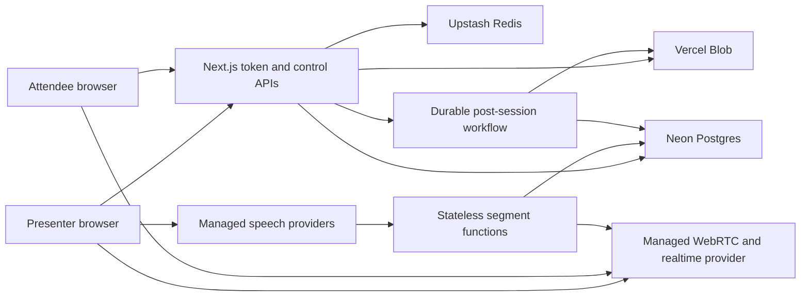

# Prastuti serverless architecture

## Objective

Keep all authored application code in JavaScript and TypeScript while allowing Prastuti-owned compute to scale to zero when there are no active sessions.

This is a cost objective, not a promise of a zero invoice. Persistent storage, domains, observability retention, and provider minimum charges can remain while compute is idle.

## Runtime topology

## Selected stack

| Concern | Selection | Scale-to-zero behavior |
| --- | --- | --- |
| Web and control plane | Next.js 16 App Router on Vercel | Static output and functions are invoked on demand |
| API compute | TypeScript Route Handlers on Vercel Functions | No Prastuti application server remains resident |
| Relational data | Neon Postgres through its HTTP serverless driver | Database compute can suspend when inactive |
| ORM and migrations | Drizzle ORM and Drizzle Kit | Build-time tooling only; no runtime daemon |
| Ephemeral coordination | Upstash Redis over REST | Request-based service with no managed server |
| Assets | Vercel Blob | Object storage without application compute |
| Live transport | Managed WebRTC and realtime pub-sub | Provider carries persistent connections |
| Speech | Managed STT, translation, and TTS APIs | Provider capacity is consumed only during sessions |
| Payments | Razorpay or Cashfree through typed adapters | Webhooks invoke stateless functions |
| Post-session processing | Vercel Workflow, subject to beta exit criteria | Durable steps run only when work exists |
| Observability | OpenTelemetry-compatible managed backend | Usage and retention based |

## Live-session execution

1. A Vercel Function authenticates the organizer, checks the wallet, reserves credits, and issues short-lived provider tokens.
2. The presenter browser sends media directly to the selected managed speech or WebRTC provider. Provider secrets never enter the browser.
3. Finalized speech segments invoke stateless TypeScript translation and settlement functions.
4. Translated captions and audio references are published through the managed realtime provider, not held in a Prastuti WebSocket process.
5. Attendees subscribe directly with event-scoped, short-lived tokens.
6. Session completion starts a durable workflow for reconciliation, summaries, transcripts, and retention.

## Credit consistency

- Credit lots and ledger entries are durable PostgreSQL records.
- Reservations consume the earliest-expiring eligible lots inside one database transaction.
- Provider webhooks are idempotent by provider event ID.
- Settlement writes immutable usage-meter and ledger entries.
- Unused reservations return to the original lots without modifying expiry.
- Expiry is derived from the confirmed load timestamp and enforced as 365 days.

## Guardrails

- Do not introduce Express, a custom Next.js server, a continuously running queue worker, or an in-memory cache.
- Do not proxy live audio through a Vercel Function for the full session.
- Do not expose provider API keys to browsers; issue narrowly scoped short-lived tokens.
- Use the Neon HTTP driver with lazy initialization so builds succeed without provisioned environment variables.
- Keep database transactions short and retry serialization or transient connection failures.
- Do not schedule high-frequency cron requests because they prevent a clean idle period.
- Put long-running or retryable post-session work in a durable workflow.

## Provider decisions still required

- Benchmark LiveKit Cloud, Ably, and equivalent managed transport options for India latency, fan-out cost, and data residency.
- Benchmark Azure Speech, BHASHINI, and Google Cloud for supported language directions and token brokerage.
- Approve payment provider, GST invoicing, refunds, chargebacks, and credit-expiry disclosure.
- Reassess Vercel Workflow when it exits public beta or before using it for financial settlement.
